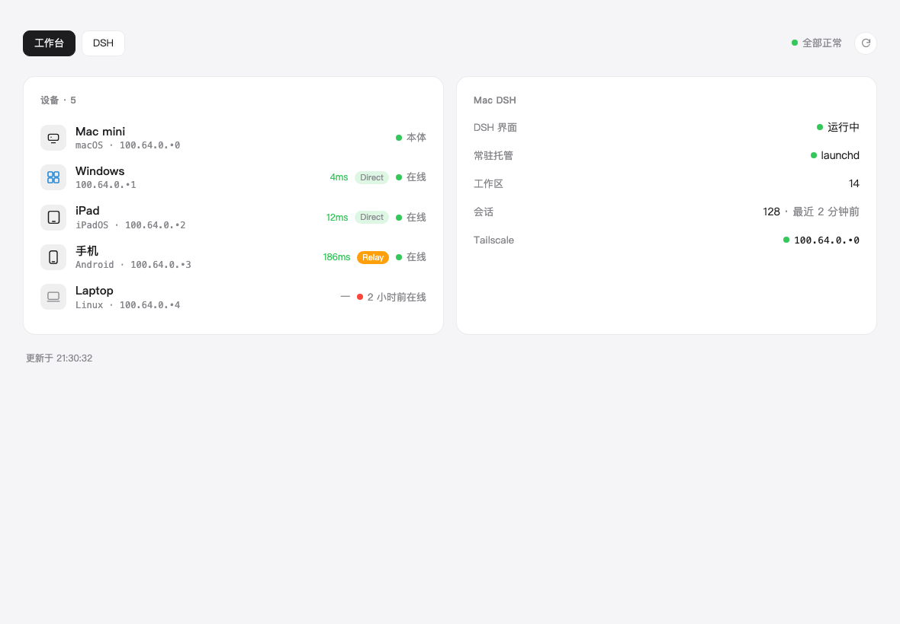

# DSH Tailnet 工作台

用 Tailscale 把家里的 Mac 或 Windows 主机（DSH 主执行端）和手机、平板、电脑组成一个只有自己设备能进的私有网。
一个只读工作台盯住三件事：

- 哪些设备接入了 tailnet，在线还是离线；
- 每台设备到主执行端的往返时延，以及走直连（Direct）还是中继（Relay）；
- 主执行端上 DSH 是否在跑、托管方式、工作区和会话。

工作台顶部点「DSH」，直接在同一个页面里进入主执行端上的 DSH。
**不开公网端口、不做端口转发、不把任何服务绑到公网 IPv6 地址。**

**主执行端必须常开、保持登录、DSH 常驻**；否则工作台和 DSH 入口都会消失。macOS 做法见 [docs/07-keep-running.md](docs/07-keep-running.md)，Windows 见 [docs/07b-windows-keep-running.md](docs/07b-windows-keep-running.md)。



> 截图为演示数据，地址尾号已打码。

## 前提

- DSH 桌面版装在 macOS 或 Windows 上，已经登录、API 可用；
- 主执行端和要接入的设备都装了 Tailscale，登录同一个 tailnet；
- 家庭宽带能拿到公网 IPv6（Tailscale 打洞会优先走 IPv6；拿不到也能退回 DERP 中继，只是慢）；
- macOS 自带 Python 3.9+，Caddy 用 Homebrew 安装；没有 Homebrew 时可用 `CADDY_BIN` 指定官方二进制；
- Windows 需要 Python 3.9+ 与 Caddy；可用 `winget` 安装，也可用 `-PythonPath` / `-CaddyPath` 指定；
- Tailscale CLI 不一定在 PATH 里：macOS 在 `/Applications/Tailscale.app/Contents/MacOS/Tailscale`，Windows 在 `C:\Program Files\Tailscale\tailscale.exe`。

## 主执行端要一直在线

工作台、反代、DSH 都跑在主执行端的图形登录会话里（macOS 是 Aqua，Windows 是交互式用户会话）。**主执行端睡眠、注销、关机，或者 DSH 退出，远程入口就会消失。**
只跑一次安装脚本不等于常驻，必须同时做到：

1. 系统不睡（显示器可以睡）；
2. 保持登录；重启后若要无人值守恢复，需要自动登录；Windows 锁屏可以，注销会杀掉计划任务；
3. DSH 常驻：macOS 用 launchd，Windows 用计划任务（或 DSH 自带的登录启动）；不常驻时工作台会显示「手动」；
4. Tailscale 随登录启动。

完整命令、验收与取舍：macOS 见 [docs/07-keep-running.md](docs/07-keep-running.md)，Windows 见 [docs/07b-windows-keep-running.md](docs/07b-windows-keep-running.md)。需要 `sudo`、管理员权限或图形界面的步骤，交给主执行端的所有者执行。

## 快速开始

### macOS

```bash
git clone https://github.com/AdarHZD/dsh-tailnet-workbench.git
cd dsh-tailnet-workbench
cp config.example.json config.json
$EDITOR config.json         # 通常只改端口；设备列表留空即可
brew install caddy          # 已有可跳过
./install.sh
./scripts/verify.sh
```

### Windows

```powershell
git clone https://github.com/AdarHZD/dsh-tailnet-workbench.git
cd dsh-tailnet-workbench
Copy-Item config.example.json config.json
notepad config.json
winget install --id Python.Python.3.12 -e
winget install --id CaddyServer.Caddy -e
powershell -ExecutionPolicy Bypass -File .\install.ps1
powershell -ExecutionPolicy Bypass -File .\scripts\verify.ps1
```

没有 `winget`、或脚本找不到 Python/Caddy 时，按 [docs/02b-windows.md](docs/02b-windows.md) 手动指定路径。

然后在任意接入设备上打开：

```
http://<主执行端的 Tailscale 地址>:8710/
```

点顶部「DSH」，第一次会经 `/remote-dsh` 换 cookie 后跳到 `:8711`，之后直接进 DSH。

> `8710`（工作台）和 `8711`（DSH 反代）只是默认值，冲突就改 `config.json` 后重跑安装脚本。
> 两个端口都只监听回环和 Tailscale 地址，不对局域网、公网开放。

## 部署完成的标志

- `./scripts/verify.sh`（macOS）或 `.\scripts\verify.ps1`（Windows）最后一行是「验收通过」；
- 工作台「Mac DSH」或「Windows DSH」行：DSH 界面「运行中」、常驻托管「launchd」或「计划任务」；
- 设备卡能看到主执行端与至少一台接入设备，时延、Direct/Relay 正常；
- 另一台设备打开 `http://<主执行端的 Tailscale 地址>:8710/`，点「DSH」能进，右上角有时延；
- 可选：重启主执行端后 60 秒内工作台恢复（没有自动登录时，先手动登录）。

## 它怎么工作

```
                  Tailscale 私有网（WireGuard）
   手机 / iPad / 笔记本  ────────────────▶  主执行端（macOS / Windows）
                                               │
                         http://<host>:8710/ ───┤ 工作台（Python，只读）
                                               │   ├─ 设备列表：tailscale status --json
                                               │   ├─ 时延：tailscale ping（直连/中继）
                                               │   └─ DSH 状态：进程端口 + ~/.dsh
                                               │
                         /remote-dsh ──────────┤ 签 DSH cookie → 302
                                               │
                         http://<host>:8711/ ───┘ Caddy 反代 → 127.0.0.1:<DSH 动态端口>
                                                  Host/Origin 固定改写 127.0.0.1:8711
```

1. 工作台页面里的 `iframe` 指向 `/remote-dsh`；
2. 工作台读本机 DSH 数据目录（macOS `~/.dsh`，Windows `%USERPROFILE%\.dsh`）里的签名密钥，为 authority `127.0.0.1:8711` 签一枚 30 天 cookie，`Set-Cookie` 后 302 到 `http://<当前主机>:8711/`；
3. Caddy 把 `:8711` 反代到 DSH 当前实际监听的端口，并把 Host/Origin 固定改写成 `127.0.0.1:8711`；
4. DSH 的 cookie 与 Host 绑定，Host 固定后，DSH 重启换端口也不会掉登录；
5. `scripts/dsh-proxy.py` 每 10 秒跟随一次 DSH 端口，端口变了就重写 Caddyfile 并重启 Caddy。

没有公网入口。IPv6 只用于 Tailscale 打洞：两端都拿到公网 IPv6 时，WireGuard 直接点对点，时延接近局域网；打不通才退回 DERP 中继。

## 仓库里有什么

```
dsh-tailnet-workbench/
├── README.md
├── AGENTS.md                  # 给另一台机器上的 DSH 读：部署顺序与硬边界
├── config.example.json        # 配置模板（config.json 永不入库）
├── install.sh                 # macOS：生成 launchd 任务并启动
├── uninstall.sh               # macOS：停止并清理 launchd / Caddy / 状态
├── install.ps1                # Windows：生成计划任务并启动
├── uninstall.ps1              # Windows：停止并清理计划任务 / Caddy / 状态
├── workbench/
│   ├── workbench.py           # 只读状态聚合 + /remote-dsh
│   └── static/index.html      # 单页看板（无外部依赖）
├── scripts/
│   ├── dsh-proxy.py           # 跟随 DSH 动态端口的 Caddy 守护（跨平台）
│   ├── verify.sh              # macOS 一条命令验收
│   └── verify.ps1             # Windows 一条命令验收
└── docs/
    ├── 01-architecture.md
    ├── 02-deploy.md           # macOS 部署
    ├── 02b-windows.md         # Windows 部署
    ├── 03-ui-spec.md
    ├── 04-latency.md
    ├── 05-security.md
    ├── 06-troubleshooting.md
    ├── 07-keep-running.md     # macOS 常开/常驻
    └── 07b-windows-keep-running.md
```

**刻意不包含**：文件/存储面板、入口链接面板、共享盘、跨机同步、SSH 隧道、任何账号、密钥、真实 IP、tailnet 名、个人路径。工作台是只读的，没有重启/挂载/删除按钮。

## 安全边界

- 唯一信任边界是 Tailscale tailnet。工作台和反代都不做公网监听，也没有密码登录；
- `config.json` 只在本机，已在 `.gitignore`；
- 工作台 API 不返回 DSH 启动 token、不返回 DSH 内部端口、不返回工作区名字；
- `/remote-dsh` 用本机 DSH 凭据现场签 cookie，凭据本身不出机器；
- Tailscale 建议给所有设备关闭 key expiry，并用 ACL 限定谁能访问主执行端的 `:8710` / `:8711`。

细节见 [docs/05-security.md](docs/05-security.md)。

## 文档

| 文档 | 作用 |
|---|---|
| [docs/01-architecture.md](docs/01-architecture.md) | 组件、数据流、为什么这么设计 |
| [docs/02-deploy.md](docs/02-deploy.md) | macOS 从零部署、升级、卸载 |
| [docs/02b-windows.md](docs/02b-windows.md) | Windows 从零部署、防火墙、升级、卸载 |
| [docs/03-ui-spec.md](docs/03-ui-spec.md) | UI 令牌、行高、图标、时延颜色、文案规则 |
| [docs/04-latency.md](docs/04-latency.md) | 时延怎么测、阈值怎么定、什么不算时延 |
| [docs/05-security.md](docs/05-security.md) | 威胁模型、隐私清单、发布前检查 |
| [docs/06-troubleshooting.md](docs/06-troubleshooting.md) | 打不开 / 401 / 502 / 没有时延 / 走了中继 |
| [docs/07-keep-running.md](docs/07-keep-running.md) | macOS 不睡、保持登录、DSH 用 launchd 常驻 |
| [docs/07b-windows-keep-running.md](docs/07b-windows-keep-running.md) | Windows 不睡、保持登录、DSH 用计划任务常驻 |

## 已验证范围

- macOS + DSH 桌面版 `0.2.2-rc.5` + Tailscale `1.104.x` + Caddy `2.11.x`：`install.sh` → `verify.sh` → `uninstall.sh` 完整循环；
- Windows 11 + PowerShell 5.1 + Python 3.12 + Caddy 2.11.x + Tailscale `1.104.x`：工作台、反代、`/remote-dsh` 302 + cookie → 200 已实测；
- 工作台在 820×1130 与 1180×820 两档视口渲染。

未做破坏性实测：DSH 重启换端口后的自动跟随；macOS/Windows 重启后的无人值守恢复（依赖自动登录，见 07 / 07b）。
Windows 的计划任务只在用户交互登录后运行；本次只在无交互会话的测试机上验证了脚本创建与手动启动，计划任务的实际拉起需登录后确认。
Windows 的 DSH 真实登录未实测：测试用假 DSH 进程 + 真实 DSH 凭据签名完成 cookie 链路。
端口跟随逻辑是 10 秒轮询 + 端口变化重写 Caddyfile，与源部署同源；
需要验证时，在 DSH 重启后看 macOS `~/Library/Logs/dsh-proxy.log` 或 Windows `%LOCALAPPDATA%\dsh-workbench\dsh-proxy.log` 是否出现新的 `DSH :<port>` 行。

DSH 的 cookie 格式是桌面版内部实现。若你的 DSH 版本改了 `~/.dsh/.credentials.yaml` 结构，`/remote-dsh` 会返回 503；
此时把 `config.json` 的 `dsh.launchLog` 指到 DSH 启动日志，回退逻辑会改用日志里的 token 入口。
